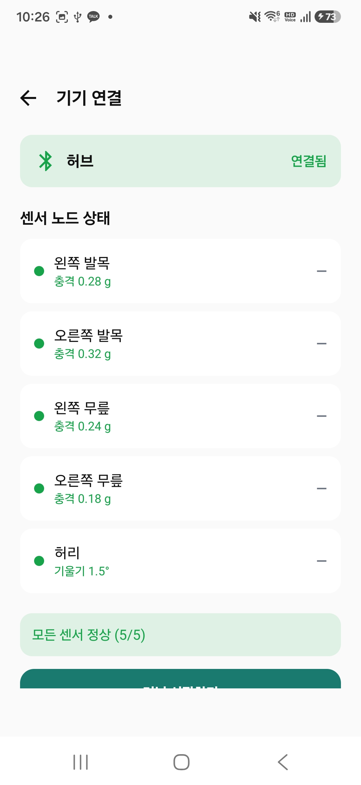
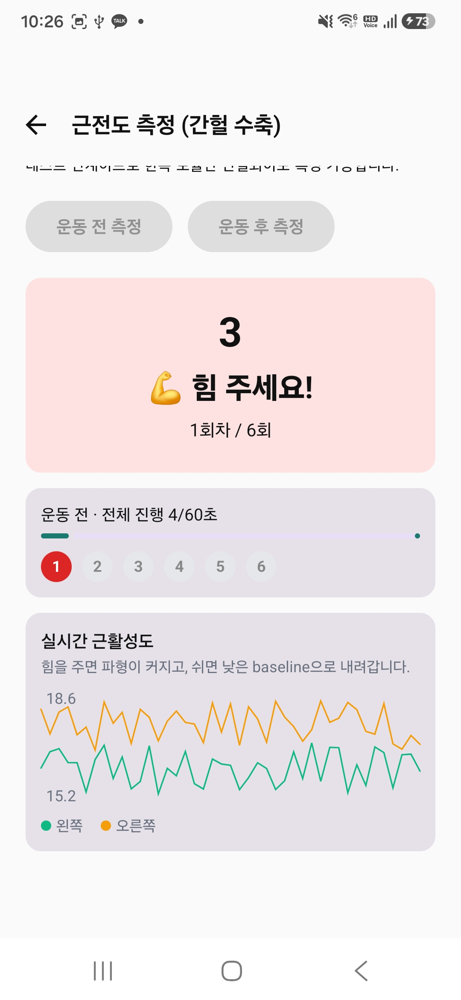
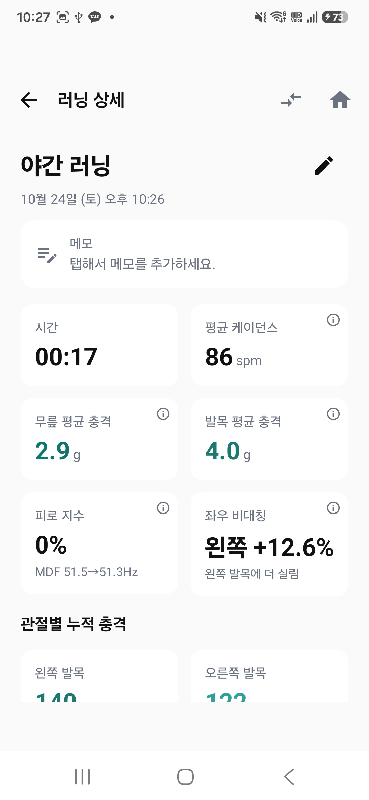

# RunTrack

**러너의 관절 충격량과 근피로를 실시간으로 측정·분석하는 안드로이드 앱**

ESP32-S3 허브와 근전도(EMG) 센서로 하지 IMU 데이터와 근피로 특징값을 수집해, 러닝 중·후의 신체 부하를 정량적으로 분석합니다.


---

## 📱 앱 화면

<!-- 스크린샷은 docs/screenshots/ 폴더에 추가 예정 -->
| 기기 연결 | 근전도 측정 | 러닝 상세(기능 확인용 짧은 테스트 세션에서 캡쳐) |
|:---:|:---:|:---:|
|  |  |  |

---

## 🎯 프로젝트 개요

RunTrack은 러너가 부상 위험을 사전에 감지하고 자신의 러닝 패턴을 이해할 수 있도록, 하드웨어와 앱을 연동해 다음을 실시간 측정·시각화합니다:

- **관절 충격량 (PTA)** — 발목·무릎 4개 부위의 peak tibial acceleration
- **좌우 비대칭** — 좌·우 발목 부하의 균형
- **근피로 지수 (FI %)** — 근전도 MDF 변화 기반 정량 지표
- **자세 무너짐 이벤트** — 상체 pitch/roll 급변화 감지
- **케이던스** — 발목 impact 간격으로 앱 자체 추정

---

## 🏆 프로젝트 컨텍스트

**한이음 드림업 (2026년 4월 ~ 10월)**  
멘토·멘티로 구성된 팀이 자유 주제로 프로젝트를 진행하는 프로그램. 5인 팀으로 하드웨어와 안드로이드 앱을 결합한 러닝 분석 시스템을 개발했습니다.

### 팀 구성 (5인)
| 역할 | 인원 | 담당 |
|---|---|---|
| **Android 앱** | 1명 (본인) | 앱 전반 설계·구현 |
| 중앙 허브 | 1명 | ESP32-S3 허브 펌웨어 |
| 근전도 모듈 | 1명 | MyoWare EMG 모듈 |
| 충격량 측정 | 2명 | 발목·무릎 IMU 모듈 |

---

## 👤 본인 담당 (Android 앱 전담)

### 핵심 기여
- **Android 앱 전체 아키텍처 설계** — MVVM + Hilt DI + Jetpack Compose 기반 반응형 구조
- **BLE 통신 구현** — 허브 + 좌·우 근전도 3링크 동시 연결·관리
- **실시간 신호 시각화** — Compose 기반 라이브 차트 (RMS, MDF, PTA 등)
- **Room DB 설계 및 마이그레이션** — 세션·충격·EMG·이벤트 스키마와 버전 관리
- **부위별 데이터 관리 기능** — 숨김·복구·완전 삭제 (요약 지표 자동 재계산)

### 기술적 도전과 해결
- **BLE 3링크 대역폭 경합** — 좌·우 EMG 동시 연결 시 통신 안정성 확보 위해 `requestConnectionPriority(HIGH)` 적용
- **하드웨어 프로토콜 미지원 지표 자체 추정** — 허브가 케이던스를 계산하지 않아, 발목 IMU peak 간격으로 앱 레벨에서 실시간 케이던스 추정 알고리즘 구현
- **비파괴 데이터 관리** — 부위별 데이터 숨김 시 원본 DB는 유지하고 조회 시점에 요약 지표를 재계산하는 구조로 설계

---

## 🛠 기술 스택

### 언어 & 프레임워크
- **Kotlin** — 앱 전체
- **Jetpack Compose** — 선언형 UI
- **Kotlin Coroutines & Flow** — 비동기·반응형 데이터 스트림

### 아키텍처 & 라이브러리
- **MVVM** — UI/비즈니스 로직 분리
- **Hilt** — 의존성 주입
- **Room** — 로컬 DB (Migration v1→v2→v3 관리)

### 통신
- **BLE (Bluetooth Low Energy)** — 허브·EMG 모듈 다중 연결
- **커스텀 프로토콜 파싱** — 텍스트 기반 EMG 특징값(5종), 바이너리 IMU 요약 패킷

---

## 🏗 시스템 아키텍처

```
┌─────────────────────────────────────────────────┐
│               하드웨어 (BLE)                     │
│  [ESP32-S3 허브]  [왼쪽 EMG]  [오른쪽 EMG]      │
│      ↓                ↓             ↓           │
└─────────────────────────────────────────────────┘
                       ↓ BLE
┌─────────────────────────────────────────────────┐
│              Android 앱                          │
│                                                  │
│   BleRunDataSource (3링크 관리·파싱·케이던스)   │
│              ↓                                   │
│   Room DB  ←→  RunRepository (재계산·FI%)       │
│              ↓                                   │
│   ViewModel (MVVM + Kotlin Flow)                │
│              ↓                                   │
│   Jetpack Compose UI                            │
│   ├─ 기기 연결   ├─ 러닝 측정                    │
│   └─ 러닝 상세   └─ 근전도 측정                  │
└─────────────────────────────────────────────────┘
```

---

## 📂 프로젝트 구조

```
runtrack-android/
├── app/
│   └── src/main/java/com/runtrack/
│       ├── data/
│       │   ├── datasource/     # BleRunDataSource, CadenceEstimator
│       │   ├── local/          # Room DB, DAO
│       │   └── repository/     # RunRepositoryImpl
│       ├── domain/
│       │   ├── model/          # RunSession, TelemetryFrame 등
│       │   └── analysis/       # FatigueAnalyzer, RunAnalysis
│       ├── ui/
│       │   ├── device/         # 기기 연결 화면
│       │   ├── liverun/        # 러닝 측정 화면
│       │   ├── detail/         # 러닝 상세 화면
│       │   ├── fatigue/        # 근전도 측정 화면
│       │   └── components/     # 공용 UI 컴포넌트
│       └── di/                 # Hilt 모듈
└── docs/
    └── screenshots/            # 앱 화면 캡처
```

---

## 📝 라이선스

MIT License
